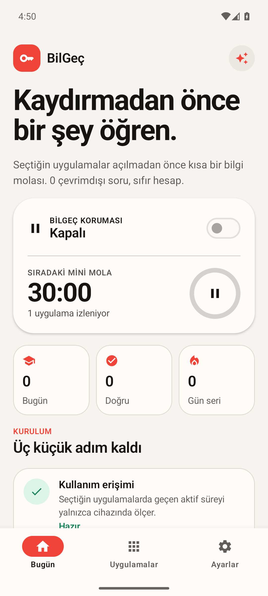
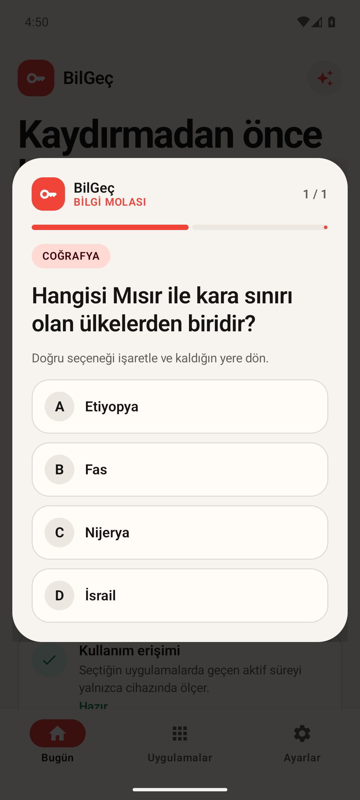

# BilGeç

BilGeç, seçtiğiniz sosyal medya uygulamalarındaki toplam aktif süreyi cihazda sayar. Ayarlanan süre dolunca açık uygulamanın üzerinde dört seçenekli kısa bir genel kültür sorusu gösterir. Yanıttan sonra sayaç sıfırlanır ve kullanıcı kaldığı yere döner.

Hesap, reklam, sunucu veya çalışma anında internet bağlantısı kullanmaz. Soru geçmişi ve istatistikler yalnızca cihazda saklanır.

## Özellikler

- Instagram, TikTok, X, YouTube, Facebook, Reddit ve Snapchat için ortak aktif kullanım sayacı
- 15, 30, 45 ve 60 dakikalık soru aralıkları
- Bir saat veya gün sonuna kadar duraklatma
- 3.082 kolay ve orta seviyeli çevrimdışı soru; bayraklar, coğrafya, temel bilim, tarih, sanat, doğa ve spor
- Görülmemiş bilgileri önceleyen, `factKey` tabanlı tekrar önleme
- Günlük çözülen/doğru sayısı ve günlük seri
- Açık, koyu ve sistem teması
- Yeniden başlatma sonrasında takip servisini geri yükleme

## Ekran görüntüleri

| Ana ekran | Soru ekranı |
| --- | --- |
|  |  |

## Derleme

Gereksinimler: Android Studio, Android SDK 36 ve JDK 17 veya daha yeni bir sürüm.

```powershell
.\gradlew.bat testDebugUnitTest assembleDebug lintDebug
```

Debug APK `app/build/outputs/apk/debug/app-debug.apk` konumunda oluşur.

Soru veritabanını kaynak verilerden yeniden üretmek için önce Room şemasını derleyin, ardından veri aracını çalıştırın:

```powershell
npm install
.\gradlew.bat compileDebugKotlin
npm run generate-data
```

Veri kaynakları [data/SOURCES.md](data/SOURCES.md), lisans bildirimleri [THIRD_PARTY_NOTICES.md](THIRD_PARTY_NOTICES.md) dosyasındadır.
